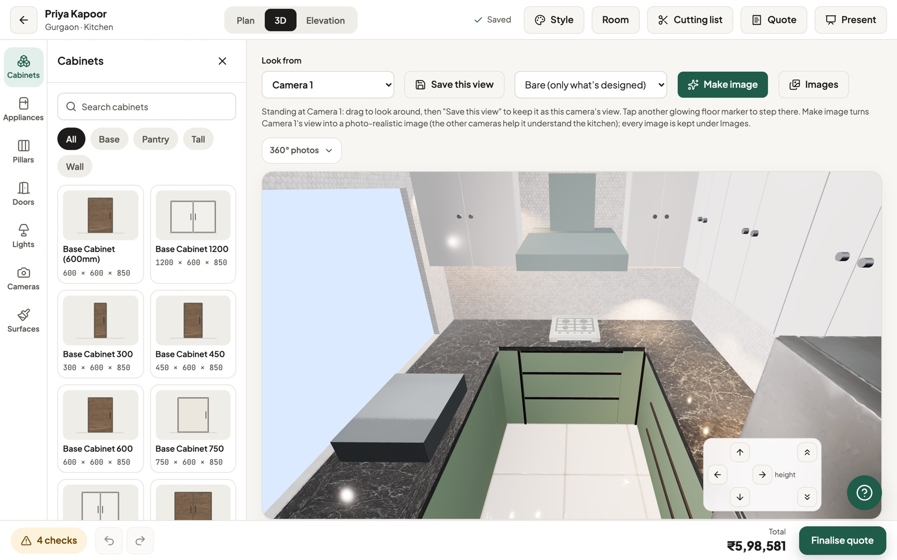
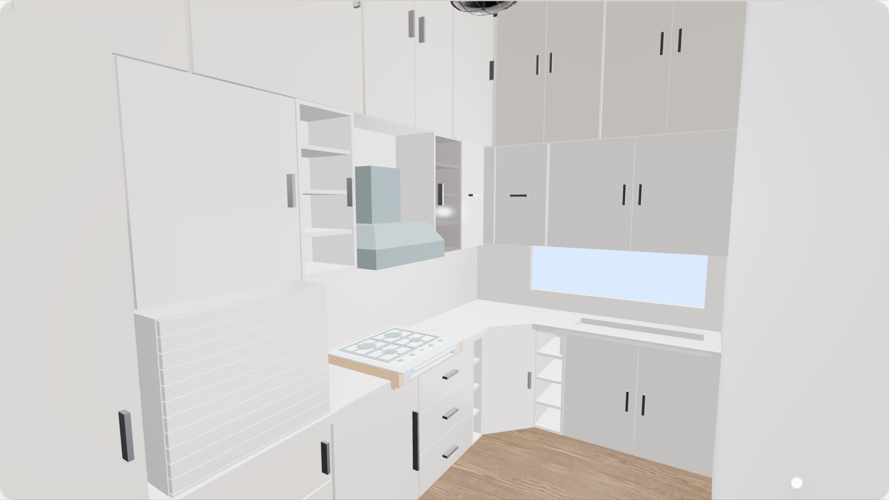
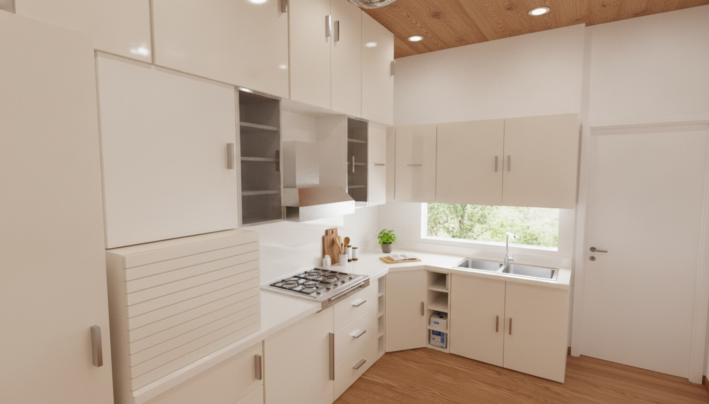
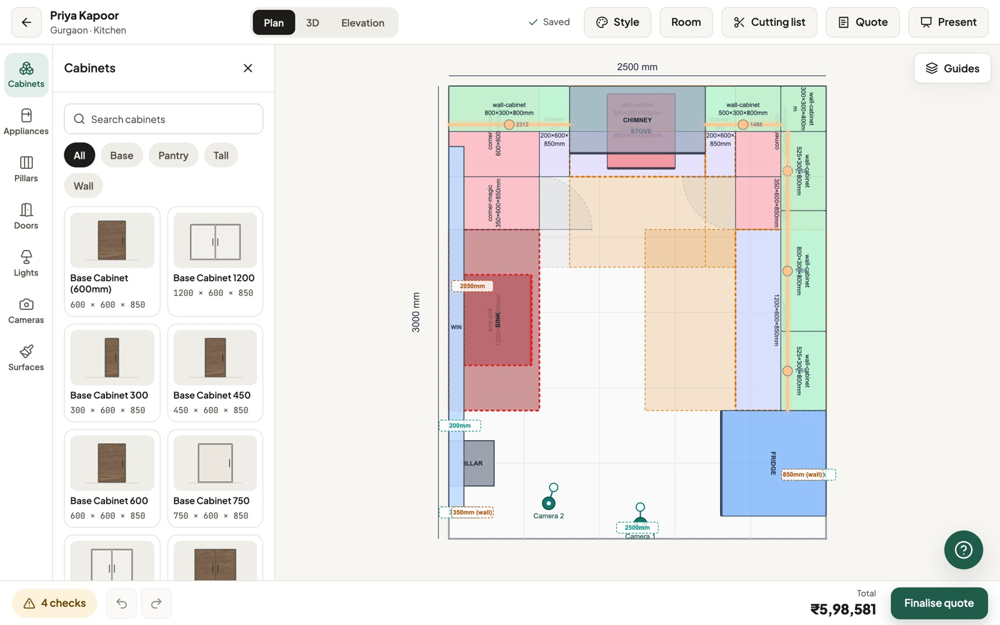
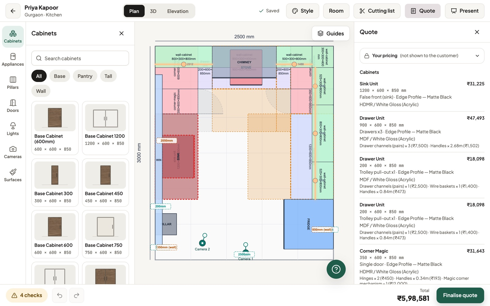
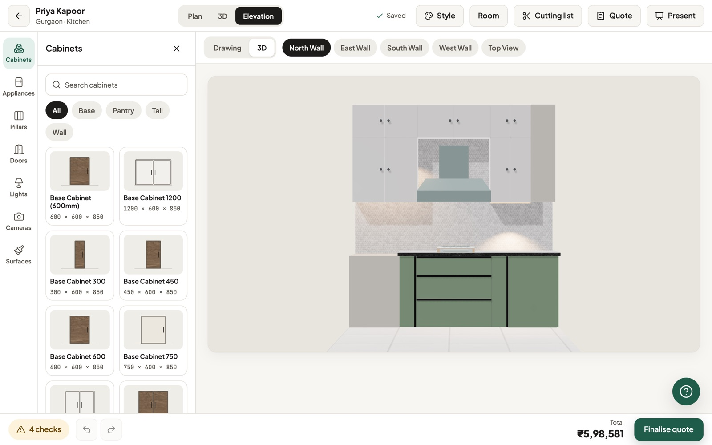
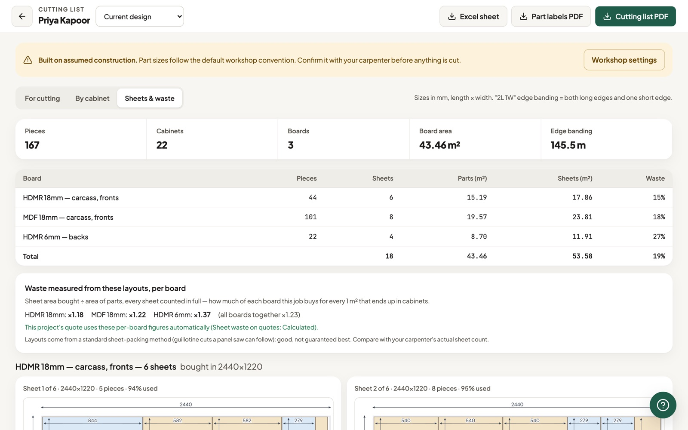

# Kitchen Studio: design, quote and build modular kitchens

A web app for small interior businesses in Delhi NCR. You draw a customer's kitchen in 2D, walk through it in 3D, send an itemised quote on WhatsApp, and hand the workshop a cutting list, all from one drawing. AI adds two things: photo-realistic images of the design, and an in-app help assistant.

**Live demo:** https://my-app.divyanshgoyal240.workers.dev
Sign in with **`demo@kitchenstudio.app`** / **`PassWord1`**.
The demo account has sample customers and kitchens. Change anything you like: nothing is saved, and a refresh starts over. AI features are switched off on the demo, because they cost money per use.



---

## What it does

| Step | In the app |
|---|---|
| **Customers** | A pipeline board (Lead → Layout drafted → Quote sent → Approved → In production → Installed) with notes, install dates and history. |
| **2D plan** | Drag cabinets, appliances, doors, windows and pillars into the room. Units snap to walls and to each other, collisions are checked in 3D (by height too), and blind and magic corners are handled. |
| **3D and elevations** | A walkthrough from cameras placed on the plan, wall elevations, 360° photos, real materials (laminates, stone, tiles) and lighting. |
| **Quote** | Every cabinet is priced from its real cut-part sizes, board, finish and hardware. The margin is spread into every line, discounts are supported, and the quote exports to PDF or a WhatsApp link. A sent quote is frozen as a version; editing the design afterwards makes a new version. |
| **Production** | A cutting list per board, sheet nesting with waste, edge banding, part labels as PDF, and an Excel export for the carpenter. |
| **AI** | **Make image** sends the design to Gemini and gets back one photo-realistic image. A **Help** assistant answers "how do I…" questions about the app. Both have per-business daily, weekly and monthly limits. |

**From the 3D model to a photo-realistic image.** Make image sends Gemini the camera's view, the other cameras' views and a structured brief (every cabinet, finish and size, plus a list of things not to invent):

| The app's 3D view (input) | Gemini's image (output) |
|---|---|
|  |  |

| | |
|---|---|
|  |  |
|  |  |

## Engineering highlights

- **Multi-tenant from day one.** Every table carries a `business_id`, and Postgres row-level security scopes every read and write to the signed-in user's business. [`supabase/isolation_check.sql`](supabase/isolation_check.sql) shows that two businesses can't see or touch each other's data. The public demo uses the same mechanism: the database refuses all writes from it, and the client answers them locally so the app stays fully interactive.
- **A pricing engine you can trust.** `calculateBOM` takes one required pricing context, with no defaults. Defaults once silently priced hardware at ₹0, so they were removed. Board is priced on the cutting list's actual parts. Frozen quotes never change. Whether a quote is out of date is decided by a **content fingerprint** of everything that was priced, not by timestamps.
- **One coordinate model for 2D and 3D.** The plan is in millimetres (Konva) and the 3D view in metres (three.js / React Three Fiber). Rotation-invariant footprints keep collisions, snapping, the countertop and the cutting list consistent.
- **AI behind a server.** API keys never reach the browser. Usage limits are enforced in the database and fail closed. Image prompts can be versioned and A/B-compared by the admin, and one prompt is chosen for production.
- **Tested.** About 380 Vitest tests: pricing, geometry, nesting, the Worker endpoints, plus screen tests in jsdom. Database rules are checked against a real Postgres.
- **Decisions are written down.** [`docs/DECISIONS.md`](docs/DECISIONS.md) records 138 decisions: what was chosen, what was rejected, and why, including the bugs that taught each lesson.

## Architecture

```
                     ┌──────────────────── Cloudflare ─────────────────────┐
 Browser ──────────▶ │ Static assets (the React app, served from the edge) │
 (React SPA)         │                                                     │
     │  /api/*  ───▶ │ Worker (worker/)                                    │
     │               │  ├─ /api/help   → RunPod (Qwen3-4B on vLLM)          │
     │               │  └─ /api/render → Durable Object pinned to the US    │
     │               │                     → Google Gemini (image model)    │
     │               └──────────────┬──────────────────────────────────────┘
     │                              │ checks sign-in and usage limits as the user
     ▼                              ▼
 Supabase: Postgres + RLS, Auth, Storage (photos, renders, PDFs)
```

## Hosting on Cloudflare

The whole app is **one Cloudflare Worker with static assets** ([`wrangler.jsonc`](wrangler.jsonc)):

- **The app** is the Vite build in `./dist`, served from Cloudflare's edge. Unknown paths fall back to `index.html` (single-page app).
- **Only `/api/*` runs code** (`run_worker_first: ["/api/*"]`). Every other request is a static file, so the Worker adds no latency to page loads.
- **Secrets stay on the server.** The RunPod and Gemini API keys are Worker secrets. The Worker checks the user's Supabase sign-in, asks the database whether the business still has AI allowance, calls the model, and records what was used. The browser never sees a key.
- **A Durable Object pins the Gemini call to the US.** From India, Cloudflare served requests from Singapore or Hong Kong at random, and Gemini refuses Hong Kong ("User location is not supported"). A Durable Object created with `locationHint: "enam"` makes the call from eastern North America instead. Targeted placement was tried first and didn't apply; that's recorded in [§135](docs/DECISIONS.md).
- **Deploys:** Cloudflare Workers Builds is connected to this GitHub repo. Every push to `main` builds and deploys, and other branches get preview URLs. `keep_vars: true` stops a deploy from wiping variables set in the dashboard.
- **Streaming:** Help answers stream from the model through the Worker to the browser as they're generated.

## Tech stack

React 19 · TypeScript 6 · Vite 8 · Zustand 5 · Konva (2D) · three.js with React Three Fiber and drei (3D) · Tailwind CSS v4 with shadcn/ui · Supabase (Postgres, row-level security, Auth, Storage) · Cloudflare Workers and Durable Objects · Vitest and Testing Library · jsPDF and SheetJS · Gemini (images) · Qwen3-4B on RunPod vLLM (help assistant)

About 60,000 lines of TypeScript.

## Running it locally

```bash
npm install
cp .env.example .env        # your Supabase URL and anon key
npm run dev                 # http://localhost:5173
npm test                    # Vitest
npm run build               # type-check and production build
```

Database setup: run [`supabase/schema.sql`](supabase/schema.sql) in the Supabase SQL editor. It's idempotent, so it doubles as the migration. See [`docs/SUPABASE_SETUP.md`](docs/SUPABASE_SETUP.md) and [`docs/DEPLOY.md`](docs/DEPLOY.md) for setup and deployment.

## How it was built

I built this with an AI pair-programmer (Claude Code). I owned the product decisions, architecture, UX and review, and tested it as a user throughout. The AI wrote much of the code under that direction. The decision log and [`CLAUDE.md`](CLAUDE.md) (the working rules I gave the AI) show the process.

---

© 2026 Divyansh Goyal. All rights reserved. The code is shared for viewing; please ask before reusing it.
